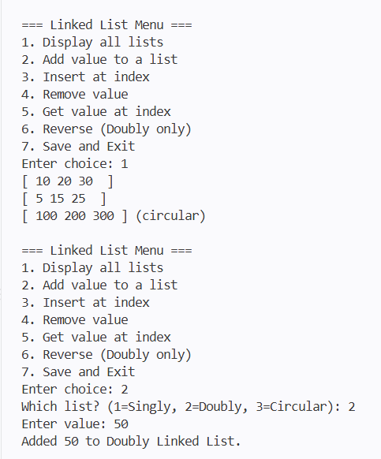
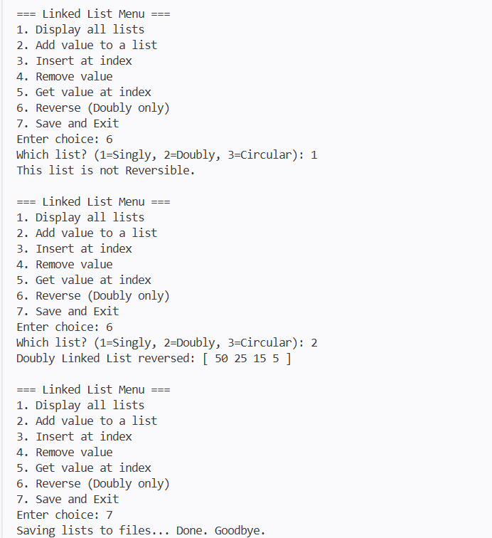
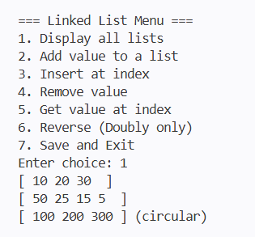

# Java_Assignment_7
Assignment: Java Interfaces and Linked Lists implementation.

## How to Compile and Run
Run these commands from the terminal

```bash
cd path/to/your/directory
javac Main.java
java Main
```

`javac` compiles all referenced source files, so compiling `Main.java` also compiles the interface and linked list classes.

## Example Output
After running `java Main`, the program prints:




